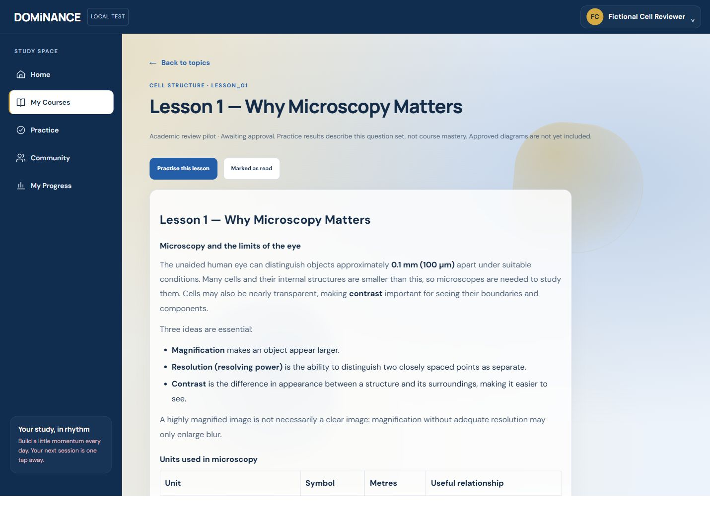
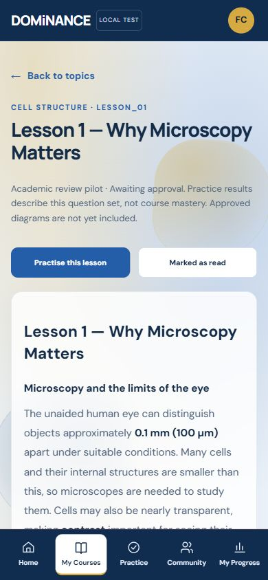
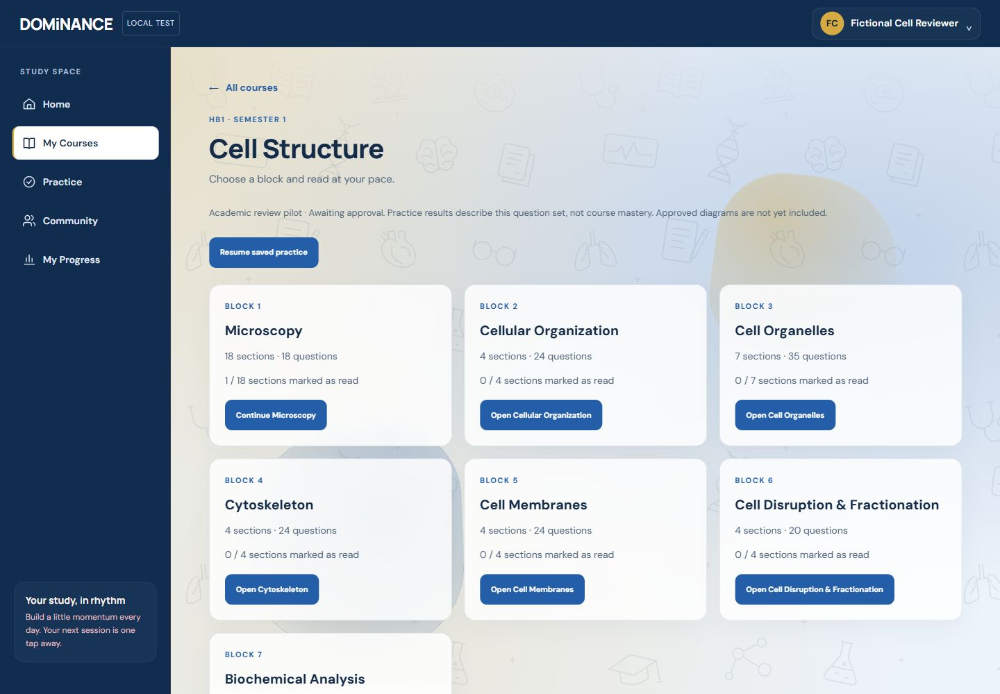
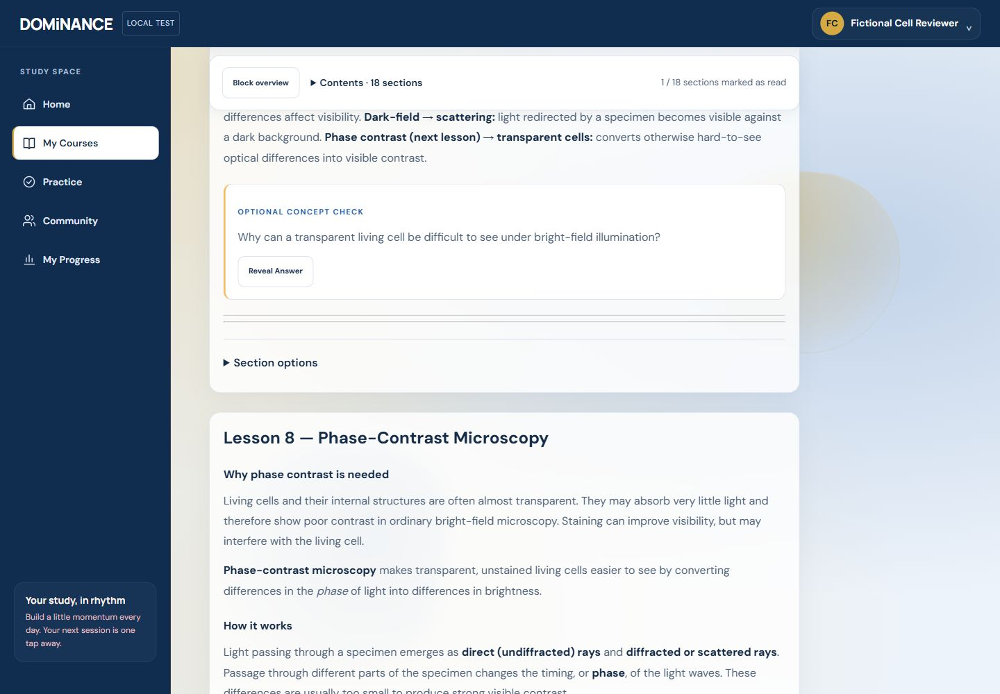
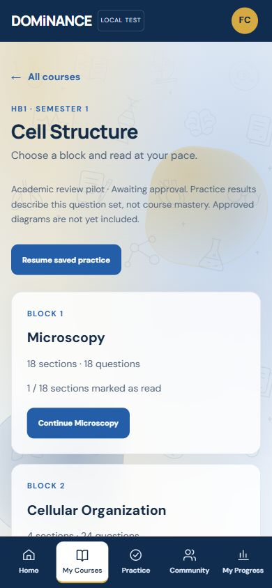
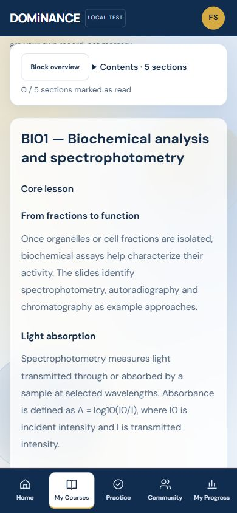
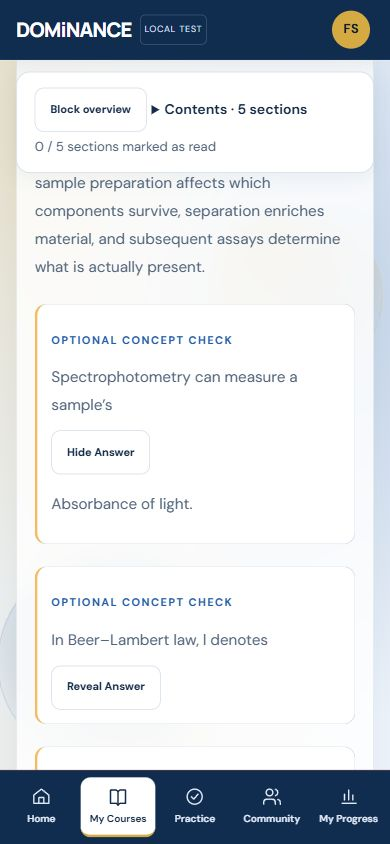
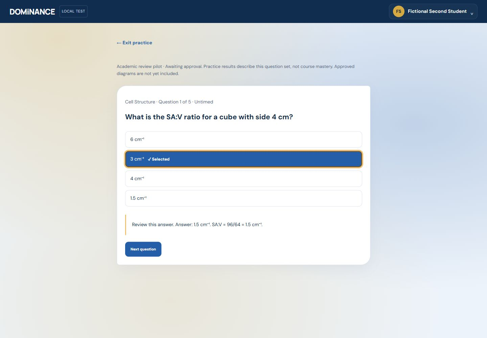

# Cell Structure pilot integration

**Current implementation (2026-10-15):** see [STABILIZATION_REPORT.md](STABILIZATION_REPORT.md) for the section-by-section reader, three course/four Practice destinations, new review/submission flow and verified results. Earlier continuous-reading and Check-answer descriptions below are historical and superseded. Academic source assets remain unchanged.

This feature adapts the supplied kit to DOMiNANCE-gls/DOMiNANCE and Firebase. The kit's original Supabase/dominance-learn deployment instructions do not apply. Phase 1 was checkpointed as 89d982a on pj/student-experience-foundation; the separate pilot branch is codex/hb1-cell-structure-content. No merge or deployment is authorized.

## Content and import

Unchanged source lessons and question JSON are versioned under content/cell-structure. schema.d.ts documents the JavaScript data contracts; no TypeScript toolchain has been introduced. Run npm run content:cell to rebuild the deterministic public/dashboard/cell-content.js student asset. npm run build recompiles it automatically. Stable source filenames and question IDs are the upsert keys: rerunning compilation replaces the same generated asset, never appending duplicate lessons/questions or writing to Firebase.

The compiler checks 46 distinct lessons, 170 distinct questions, four distinct nonempty options, valid A–D answers and valid lesson references. It removes only internal QA sections and source/status metadata from student output. Lecture content, learning missions where supplied, Slide Essentials, Concept Connections and scientific clarification notes are retained. No academic text or replacement questions were generated. Source-page citations embedded in academic explanations remain; provenance metadata fields are excluded.

No QA CSVs, original slide screenshots, inventoried figures or new diagrams are published. Diagram placement and labels require academic review. Not every question has a signed four-option scientific reconciliation, and not every lesson/figure has independent slide-by-slide approval. The pilot is explicitly labelled awaiting academic approval.

## Existing application integration

public/dashboard/cell-structure.js adds a bounded safe Markdown renderer (escaped HTML; headings, emphasis, lists, tables; no executable HTML, images, or links), seven-block overview, continuous sections with compact contents, explicit read markers, optional concept checks and lesson/block/course practice. It plugs into existing My Courses, Practice and My Progress without redesigning Home/Profile or migrating the React/iframe architecture. Existing course eligibility and favourites are preserved. HB1 Semester 1 content remains accessible for later eligible students through previous years.

Students may change a selection before Check answer. Checking locks that question and reveals the correct option and supplied explanation. Options shuffle while storing their original indices, preserving the A–D mapping. Untimed practice saves one resumable draft, including selected answers and explanation state; explicit Exit practice keeps it. Browser history uses the existing accessible confirmation. Reload presents Resume saved practice rather than silently starting a new attempt. Completion records once and retains a focused result screen with a clear return button. No timed mode, timer, official score, mastery claim, flashcards or LAMLA content engine is added.

Existing generic quizzes/LAMLA remain demonstrations with their original discard-on-exit behaviour. Cell Structure results appear in a separate My Progress panel, using acknowledged data only; they are not silently mixed into existing demo-labelled Home metrics or daily goals. Home Continue Learning can reopen the validated lesson ID; reading-position tracking is not yet supported.

## Persistence, access and migration

The authenticated parent owns identity. Additive users/{auth.uid}.dashboardState.cellStructure JSON uses the existing private profile document and authenticated storage adapter. Completion histories and read markers merge in a Firestore transaction, deduplicating attempt IDs. One in-progress draft per account uses last-writer behaviour across tabs; simultaneous independent drafts are not supported. Pilot limits: 100 completed attempts and the existing 100,000-character field limit; capacity failures preserve records and report a save error rather than pruning history.

UI history is self-reported and client-editable, never an authorization source or certified examination record. Existing production Firestore rules were neither edited nor deployed. Emulator rules deny ordinary students access to another student's private profile/state; existing super-admin permissions are unchanged. Academic level filtering is navigation policy, not a new content secrecy boundary: the compiled lessons/questions are static application assets and can be fetched directly. A paid/licensed or secure assessment release would need separately approved protected content delivery and server-side grading. No such release is claimed here.

No ambiguous legacy browser data is imported. Existing demo histories/preferences/profile values remain separate. Failed writes use the existing sync banner and Retry; unacknowledged data is memory-only and is not guaranteed to survive closing/reloading while offline. Corrupt pilot state is not overwritten. No production test accounts, requests or data writes were used.

No database migration or admin seed is necessary. Rollback: revert the pilot integration commit to the Phase 1 checkpoint; leave the additive private field intact for a future reviewed migration. Do not delete student data to roll back UI code.

## Verification and review

See the draft PR for final command results and UI captures. Use fictional accounts on demo-dominance only: npm run emulators, npm run dev:emulator, npm test, npm run test:emulators, npm run lint and npm run build. Review the 46/170 source package academically before considering merge. Ofobi's GitHub reviewer handle is not established; do not guess an account or send unsolicited messages.

Physical touch devices, screen readers, production Firebase behaviour and exhaustive scientific/figure review remain outside verified results. A narrow supported Markdown subset is intentional; future content requiring links, code/math blocks or figures needs a reviewed renderer extension.

## Follow-up onboarding clarification

The intended student flow is year and applicable semester, with eligible courses provided automatically. All eligible courses already appear in My Courses without manual favourites. The optional onboarding/Home favourites picker remains from Phase 1 under the explicit preserve-selection constraint. Remove that onboarding step and reconcile the Home empty-state wording in the next separately reviewed correction; it is not a prerequisite for this pilot and must not become a course-access gate.

Initial pilot verification (before continuous reading refinement): 83 automated tests passed; the real isolated Auth/Firestore integration scenario passed (including expected cross-account permission denials); lint passed with the same eight pre-existing legacy React warnings; production build passed with the existing bundle-size warning. The shared validation/index split keeps academic text out of the React account bundle (1,082.78 kB final versus 1,075.26 kB Phase 1, before gzip). The generated content is loaded by the authenticated iframe.

Actual interface checks: fictional registration/onboarding, course opening/search, lesson/table rendering, mark-as-read, selection changes, checking/explanations, one-question completion, reload/Resume, Escape cancellation, confirmed exit preserving the draft, Home Continue Learning, confirmed My Progress results, sign-out/account switching and return-to-first-account persistence. A second fictional HB1 student selected no favourites and still saw Cell Structure in My Courses, with zero activity from the first account. Desktop and 390px layouts checked; phone reader had equal document client/scroll widths (380px) and contained table scrolling. Automated UI-handler tests additionally completed a six-question lesson. Physical touch and screen-reader testing remain unverified.

Review images (fictional emulator account only):

## Continuous reading refinement

The presentation mapping is public/dashboard/cell-learning.js: seven blocks, with Microscopy's optical foundations (1–6), imaging methods (7–12) and specimen preparation (13–18) chapters based on their actual section subjects. Every source lesson appears exactly once; Cytoskeleton precedes Cell Membranes as requested. The 46 original source files and 170-question JSON remain unchanged.

There are 51 embedded checks with unambiguous supplied answer delimiters: 20 in Microscopy, six in Cell Disruption & Fractionation and 25 in Biochemical Analysis. Other blocks have no embedded checks; none were invented. Questions using Answer markers, trailing italics, or numbered/bulleted trailing bold answers are parsed. All supplied answer text is kept behind Reveal Answer; Hide Answer removes it from the rendered DOM again. No check affects scores/read markers or blocks navigation. Missing/ambiguous delimiter formats produce an unresolved review item rather than a guessed answer. No additional explanations are supplied where the source gives only an answer.

The student compiler also suppresses figure-placement/editorial cover notes; the original sources retain them. Approved diagrams remain absent. Scientific clarifications and all substantive lesson text remain visible. The source OR01 repeats an uricase clarification in two separate Understanding Notes; both are intentionally retained pending academic reconciliation rather than silently deduplicated. The extra editorial course/next-group heading in lesson_12 is omitted from student presentation, not the academic specimen-preparation content.

Reading resume adds optional reading[blockId] records to the existing version-1 state: validated source section ID, clamped section-relative offset and timestamp. Earlier state remains valid and is not silently overwritten. Positions merge by newest timestamp per block; read markers and completed results keep their prior merge behaviour. Section jumps save immediately; scrolling saves after a 700ms pause; leaving reading captures the current position. Resume is approximate because fonts/layout/device width can change. Changes are durable only after acknowledgement, not while offline/pending. Read counts are explicit self-reported marks; scroll offset is not a completion percentage. Legacy lesson links map into the appropriate block and new resume entries use stable block routes.

Practice This Block reuses the existing engine and source question IDs. Students can choose five, ten or all mapped questions where available; short sets sample without replacement. An existing unfinished session is resumed rather than overwritten, including if it belongs to a different selection. Lesson-level practice remains inside each section's collapsed options; course-wide practice remains in Practice. No timed mode or second question system was added.

The active iframe assistant/chat and launch functions were removed. Legacy assistant destinations resolve to Home, and the five tabs remain. One noninteractive Home item states AI Study Assistant — Coming Soon. Unreachable legacy React components are still dormant after the authenticated dashboard return; they are not student-accessible and no new AI/background request is initiated. The onboarding favourites-picker correction remains separate.

### Refinement verification — 2026-10-15

Final npm test: **93 passed**. The isolated real Auth/Firestore integration passed, now including saved section/offset and relogin assertions, alongside existing account switching and denied cross-account operations. Lint passes with the same eight legacy React warnings; build passes with the existing large-bundle warning. git diff --check passes. git diff against caebf76 confirms all 46 original lesson files and the original MCQ JSON are unchanged. Production Firebase files/rules are unchanged.

Actual UI: seven-card overview, chapter contents, continuous sections, reveal/hide on desktop and phone, sticky overview return, section jump and reload restore beneath the toolbar, five-question block selection, answer explanations, reload to question 2/5, Escape cancellation and completion to a saved block-labelled result. A second account had separate zero markers/history before practice; the original account's pre-existing full-course draft remained at question 5/170. Existing drafts were not discarded for testing. All accounts/data were fictional and emulator-only. Reading position is approximate and only acknowledged writes are durable. A transient sign-in error during scripted account switching resolved on re-entering the same fictional credentials; no authentication code was changed.

Phone checks at 390px: seven block cards, five continuous Biochemical Analysis sections, 25 unrevealed/empty answer containers, and no document-width overflow. Physical touch, assistive technology/screen readers, exhaustive science review and production behaviour remain unverified. There are no unresolved embedded-answer delimiter mappings in the supplied 51 checks; scientific correctness and missing richer explanations are still academic review concerns. Approved diagrams remain absent. The OR01 duplicate clarification is retained for academic reconciliation.

Current review captures:

No merge, deployment, Firebase configuration/rules change, automatic course assignment or favourites-picker removal is included.
