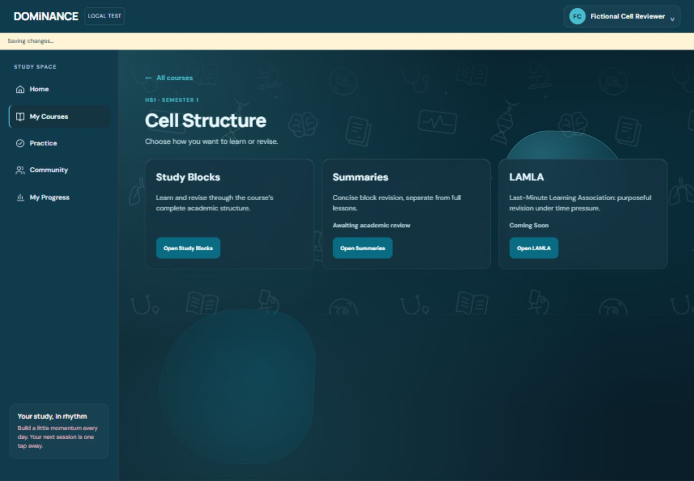
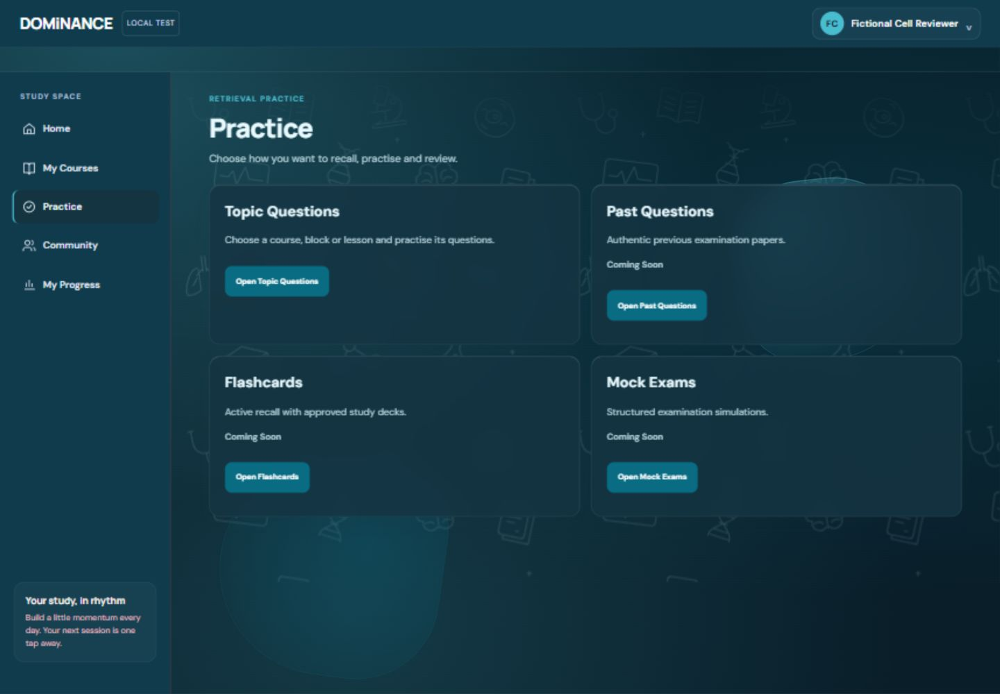

# Stabilization and course/Practice architecture — 2026-10-15

Implemented on `codex/hb1-cell-structure-content`, continuing `3d78716`, for [Draft PR #1](https://github.com/DOMiNANCE-gls/DOMiNANCE/pull/1), base `pj/student-experience-foundation`. The worktree was clean at baseline. Phase 1 remains in the base branch. No merge, deployment, production Firebase request, production configuration/rules change or ambiguous-record migration.

## Observed causes and before → after evidence

| Issue and reproduction | Before / root cause | Implemented fix and after verification |
|---|---|---|
| Open Preferences, select another theme/mode without Save | Root changed from Signature / ink `#152c49` to Bloom / ink `#fff0fb`. Theme Studio invoked the parent's global preview, which propagated to the iframe. | Scoped miniature tokens only; legacy iframe preview is nonmutating. Save waits for one atomic authenticated profile update. Ocean/Dark miniature `#e9faff` left the workspace Signature/Light `#152c49`; Cancel preserved the saved theme. |
| Select a practice answer and observe sync banner | DOM geometry trace: iframe top **68 → 110.104px** while the conditional Saving region entered layout. This was a real ~42px parent layout shift. | Permanent 36px status slot and matching iframe height; repeated answer selection measured **104 → 104px**. Selected-state tick is absolute with reserved padding; selection updates attributes instead of rebuilding the question. |
| Progress/profile snapshots during Practice selection | Code inspection found every profile snapshot rebuilt academic controls, including after answer writes. Count-reset risk identified; a standalone count-reset glitch was not independently reproduced before editing. | Only academic-field changes rebuild curriculum controls; same-permission Practice renders preserve controls. Browser switched 10 → All 24 → 5, then started exactly five. New tests retain the selector across unrelated refreshes. |
| Question revisits | Code previously reshuffled on rerender. This was identified in source, not separately recorded as a before-browser failure. | Deterministic per-session/per-question option order; original answer indices retained. Previous/Next/reload restored the same selected source option. |
| Section reader checks | Integrity probe while implementing sections detected 31 checks in CE01/BI01–BI05 losing their hidden-answer grouping when the section heading was removed. | Preserve the parser's check-heading context. New regression compares every before/after question and answer: **51/51** retained, no unresolved delimiters. Browser checked BI01 reveal/hide and reload. This was caught locally before delivery. |

Before screenshots were captured for the two reproduced browser problems before their fixes. Recording was unavailable/not used; paired screenshots plus DOM/token traces are the timing evidence, not a claim that a still image proves timing behaviour. No blanket claim that every reported intermittent flicker was reproduced or eliminated. Opening sections and repeating selection/navigation after fixes did not reproduce additional flickering in the tested browser.

[Theme before](review/stabilization-theme-before.png) · [Leaking preview](review/stabilization-theme-leak.png) · [Isolated preview after](review/stabilization-theme-after.png) · [Failed save](review/stabilization-theme-failed-save.png)

[Quiz before](review/stabilization-quiz-before.png) · [Saving layout before](review/stabilization-quiz-saving.png) · [Stable quiz after](review/stabilization-quiz-after.png)

## Student journeys and availability

- My Courses → any eligible course → **Study Blocks | Summaries | LAMLA**. Courses without approved material show unavailable destinations, rather than fabricated topic outlines.
- Cell Structure → Study Blocks → seven blocks (18/4/7/4/4/4/5 lessons) → readable within-block Lesson N titles → one natural-length section. Previous/Next, contents select, course/block exits, focused layout, source information and optional revealable checks remain accessible. No fixed-height tiny slides or duplicate hide/show navigator.
- Summaries has seven block entries, all awaiting academic approval. Existing Slide Essentials remain inside full lessons; they are not promoted to approved block summaries.
- LAMLA means **Last-Minute Learning Association**, Coming Soon. It is distinct from Summaries; the legacy LAMLA route also shows Coming Soon. Historical demo code/data is retained, not presented as the new workflow.
- Practice → **Topic Questions | Past Questions | Flashcards | Mock Exams**. Topic Questions independently selects available course/block/lesson/count and reuses the 170 supplied MCQs. Other destinations are honest Coming Soon: no authentic past papers, approved decks or mock rules are supplied.
- Five/ten/all counts derive from actual pools. Existing draft takes priority over starting another set. Stable shuffled options, changed answers, Previous/Next, jump with unanswered status, review before submission, intentional marking, explanations, saved history and retry are implemented. Results are personal practice, never certified examination grades.
- Signup/onboarding asks display name, level and applicable HB1 semester, without a course/favourites picker. A newly created fictional account entered successfully and saw its eligible courses. Existing profiles/course preferences remain compatible; this is eligibility visibility, not a new compulsory-assignment feature.
- Theme Studio preview is scoped. Cancel, close and reopen discard unsaved draft; explicit Save persists before global application. A write-denied emulator test showed a retryable error and preserved draft without changing the workspace. Restoring the emulator rules and retrying saved Ocean/Dark; reload retained it, and another account kept its own appearance.

## Persistence and compatibility

Identity remains authenticated parent state; URLs/history/browser storage never authorize private data. Existing Firebase owner rules are unchanged. Existing original full-course 170-question draft survived account switching and resumed at question 5 with its prior answers.

`cellStructure` remains version 1. Legacy already-owned sequential drafts upgrade to `format:2` response maps on explicit resume, retaining IDs, question order, prior answers and current selection. Completed answers may use `null` for unanswered. New reading records retain stable lesson IDs and add optional zero-based `part`, approximate offset and date. Existing records without `part` remain valid; old whole-lesson offsets are not guessed onto a different section. They open that lesson's first section and remain unchanged until a new location is actually recorded. No data is deleted or imported from ambiguous device-local storage.

Read markers are explicit lesson acknowledgements, separate from reading locations and practice performance. Unacknowledged writes remain memory-only; wait for the sync status to clear before reload. One draft/account uses existing last-writer semantics across tabs. The existing 100-attempt / 100,000-character field bounds remain. No full offline queue or multi-device draft conflict resolution is claimed.

## Academic and source review

All 46 original lesson Markdown files and original MCQ JSON remain unchanged. The generated student asset moves only unambiguous parenthesized source-page annotations to optional Source information, preserving attribution and original source/provenance internally. Complex/meaningful references, scientific clarification distinctions and ambiguous numbers are retained. No diagrams or slide images added.

All **92 components** inspected: **50 effective**, **34 useful but unclear**, **4 questionable**, **4 exact duplicates**. Shared formatting is implemented; four exact duplicate BI connections link to the original. OR01 consolidates a duplicate heading while retaining both distinct note bodies. No substantive scientific rewrite/correction is published. The 38 unclear/questionable nonduplicate components have approval-dependent proposals; software tests are not academic certification. [Review and examples](EDUCATIONAL_REVIEW.md), [92-row CSV](review/EDUCATIONAL_COMPONENT_REVIEW.csv), [exact text and assessment JSON](review/EDUCATIONAL_COMPONENT_REVIEW.json).

## Verification

- Baseline: **93/93** automated tests passed before changes.
- Current: **100/100 automated tests passed (0 failed, 0 skipped)**, plus **one real isolated Auth/Firestore integration scenario passed**. Coverage includes new architecture, all 51 checks, preserved paragraphs, legacy draft upgrade, unanswered scoring, deterministic choices, counts, per-account ownership, section reload, quiz resume and original content mappings.
- Emulator integration covers signup/sign-in, profile edits, recovery request, sign-out, account switching, denied cross-owner reads/writes/subscriptions, private legacy and new-format drafts/results/section positions across relogin. Expected permission-denied logs are passing negative tests. Fixed demo-dominance/loopback only; temporary deny-writes override restored.
- Lint: zero errors, eight pre-existing warnings in dormant legacy React screens. Build passes, with existing large-bundle warning. No failing tests removed. Assertions tied to superseded continuous-reader/Check-answer behaviour were replaced with new section/review contracts while preserving content/isolation protections.
- Actual desktop and 390px browser: three/four landing pages, block/lesson/section navigation, keyboard Enter on section/answer controls, selected status, reveal/hide, reader reload, five-question answer changes, Previous/Next, reload/resume, review/unanswered submission and explanations/history; real ten-question and All Available 18-question sessions; Escape defaults to cancellation; mobile-width cancel/confirm preserves saved draft; account switching preserves original account records.
- Theme verification: six palettes × light/dark token tests meet 4.5:1 body/muted/button/nav text and 3:1 focus/control boundaries. Academic surfaces, dropdowns, answers and results use semantic tokens. Actual light and Ocean/Dark interfaces inspected. This is not a full rendered-state WCAG certification across every screen.
- Narrow tested reader/Practice DOM widths: scrollWidth equals clientWidth (380px within the 390px viewport/scrollbar). Tables scroll within their own wrapper. Viewport override reset after testing.

Not verified: physical touch/swipe devices, assistive screen-reader output, exhaustive browser/OS/font/performance combinations, full offline recovery or concurrent-draft reconciliation, production Firebase/deployed-rule parity, complete lecturer-slide scientific reconciliation, question-by-question academic certification, diagram approval and measured educational effectiveness. Internal Practice subdestination is intentionally not persisted as identity-bearing URL state: reload returns to Practice landing, with explicit draft resume inside Topic Questions.

## Review demonstration

Local isolated preview: http://127.0.0.1:5174/

1. Open My Courses → Cell Structure; inspect three destinations, then Study Blocks → a block → Lesson 1. Use section select/Previous/Next and a supplied check; wait for sync, reload and resume.
2. Open Practice → Topic Questions → course/block/lesson → five/ten/all. Existing drafts resume first. Change an answer, go back/forward, review and submit intentionally; expand explanation and inspect saved results.
3. Open Preferences, preview a different palette/mode; workspace stays saved. Cancel or Save intentionally, then reload.

[Course mobile](review/stabilization-course-mobile.png) · [Practice mobile](review/stabilization-practice-mobile.png) · [Reader desktop](review/stabilization-reader-desktop.png) · [Reader mobile](review/stabilization-reader-mobile.png) · [Review mobile](review/stabilization-review-mobile.png) · [Results mobile](review/stabilization-results-mobile.png) · [Onboarding mobile](review/stabilization-onboarding-mobile.png)

Next: user/Ofobi manual and academic review of Draft PR #1 and substantive proposals. No merge/deploy approval implied.
